<a href="https://radyelkasas.com/">
  <picture>
    <source media="(prefers-color-scheme: dark)" srcset="assets/banner-dark.svg">
    <source media="(prefers-color-scheme: light)" srcset="assets/banner-light.svg">
    
  </picture>
</a>

<p align="center">
  <a href="https://radyelkasas.com/"></a>
  <a href="https://linkedin.com/in/radyelkasas"></a>
  <a href="mailto:hello@radyelkasas.com"></a>
  <a href="https://behance.net/radyeg"></a>
</p>

<p align="center">
  
  
  
</p>

## 👋 Hey, I'm Rady

I'm a **full-stack developer** who ships complete products — not just screens. I've built and launched an AI SaaS on my own,
work on school & university management systems used daily by students and staff, and I build the tools I wish I had,
like an AI QA engineer that tests web apps for me.

- 🏢 **Full-Stack Developer** at [Future Code](https://codealmostaqbal.com/ar) — academic management systems
- 🚀 **Founder** of [Koda AI](https://kodaai.site) — AI image-generation SaaS, built and launched solo
- 🧪 **Author** of [QA Scout](https://github.com/radyelkasas/qa-scout) — open-source Claude Code skill for real QA testing
- 🌍 **Arabic-first by default** — RTL, i18n and bilingual UX are part of every build, not an afterthought

## ⭐ Featured open source — QA Scout

<table>
<tr>
<td width="55%">

<a href="https://github.com/radyelkasas/qa-scout"></a>

</td>
<td width="45%">

**Tests your web app the way an experienced QA engineer does — and shows its work.**

- 🎥 Drives a **visible, recorded browser** with a red cursor
- 🧪 Clicks every button, **attacks forms**, checks permissions
- 🔗 Follows data **across pages** and verifies it at the API/DB
- 🖼️ Reports with **highlighted screenshots**, videos and an HTML dashboard

```bash
git clone https://github.com/radyelkasas/qa-scout
cd qa-scout && ./install.sh
```

<a href="https://github.com/radyelkasas/qa-scout"></a>

</td>
</tr>
</table>

## 🛠️ Products I've built

| Project | What it is | Stack |
|---|---|---|
| 🤖 **[Koda AI](https://kodaai.site)** | AI image-generation SaaS, built solo end to end — Arabic-first UI, credit-based billing, OpenRouter + fal.ai, Docker on a VPS with CI/CD and daily backups | Next.js · Express · PostgreSQL · Prisma · Docker |
| 🎓 **Tafra** | School & university management system — I lead frontend for the student, teacher and admin dashboards; installable PWA with offline support | React · Next.js · TypeScript · PWA · GSAP |
| 📚 **[El-Pasha](https://elpasha-history.com/)** | History learning platform — video courses, quizzes and student progress tracking | React · Next.js · GSAP · Framer Motion |
| 🏢 **[Future Code](https://codealmostaqbal.com/ar)** | Company website for an academic-systems (SIS + LMS) company — Arabic-first, bilingual, demo-booking flow | Arabic-first RTL · AR/EN i18n |
| 🎨 **[Getly](https://getly.art/)** | Portfolio for an Egyptian brand & graphic designer — case studies, image-led dark design, SEO-ready | Next.js · Tailwind CSS |
| 🍰 **[Teta](https://github.com/radyelkasas/Teta)** · [live](https://teta-dun.vercel.app) | Mobile-first Arabic digital menu for an Egyptian sweets shop | Astro · TypeScript |

## 🧰 Tech stack

<p>
  
  <br>
  
</p>

**Also:** REST APIs · Auth & billing · Zod · NextAuth · Framer Motion · GSAP · n8n · AI agents & LLM workflows · Playwright

## 💡 How I work

- **Ship end to end** — UI, API, database, auth, payments, deploy.
- **Test like a user** — I built QA Scout because "the page loads" isn't the same as "it works".
- **Design matters** — Figma and UI/UX are part of my toolkit, and I care about motion and detail.
- **Bilingual by design** — Arabic and English with proper RTL, from the first commit.

## 📫 Let's build something

Have a product idea, a SaaS to launch or a team that needs a full-stack developer?
**[hello@radyelkasas.com](mailto:hello@radyelkasas.com)** · [radyelkasas.com](https://radyelkasas.com/) · [LinkedIn](https://linkedin.com/in/radyelkasas)

<p align="center"></p>
